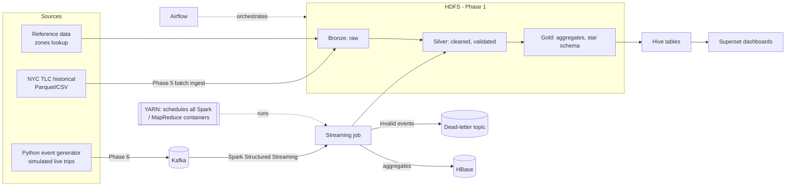
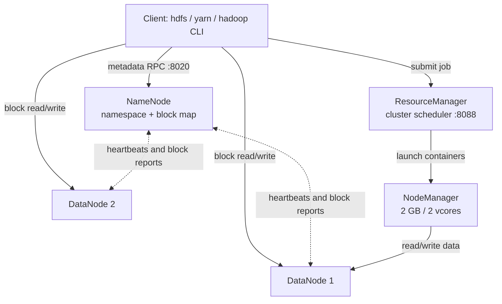

# Architecture

## Target architecture (all phases)

## What exists right now (Phase 1)

## Component roles and why each exists

| Component | Role | Why it is here |
|---|---|---|
| NameNode | Holds the file-system namespace and the map file -> blocks -> DataNodes. Stores no file data. | Single source of truth for where data lives; the thing interviewers ask about first. |
| DataNode (x2) | Stores block files, heartbeats to the NameNode, serves reads/writes directly to clients. | Two of them let us actually demonstrate replication and failure recovery. |
| ResourceManager | Cluster-wide scheduler. Grants containers (memory + vcores) to applications. | Spark and MapReduce will both request resources from it. |
| NodeManager | Per-node agent. Launches and monitors containers, runs the shuffle service. | Where tasks and executors physically run. |

## How data moves (HDFS write, as done in the verify script)

1. Client asks the NameNode to create `/phase1-verify/blob.bin`.
2. NameNode picks DataNodes for each new block and returns them.
3. Client streams the block to DataNode 1, which forwards it to DataNode 2 (the replication pipeline).
4. DataNodes ack back along the pipeline; the client moves on to the next block.
5. DataNodes report received blocks to the NameNode, which records block locations in memory.
6. Reads: client asks the NameNode for block locations, then reads each block straight from a DataNode. The NameNode never carries file data.

## How a job runs on YARN (as done by the `pi` example)

1. Client submits the application to the ResourceManager.
2. RM allocates a container for the ApplicationMaster on the NodeManager.
3. The ApplicationMaster asks RM for more containers for map and reduce tasks.
4. NodeManager launches them; reducers fetch map output through the shuffle service.
5. The ApplicationMaster reports completion and the containers are released.
