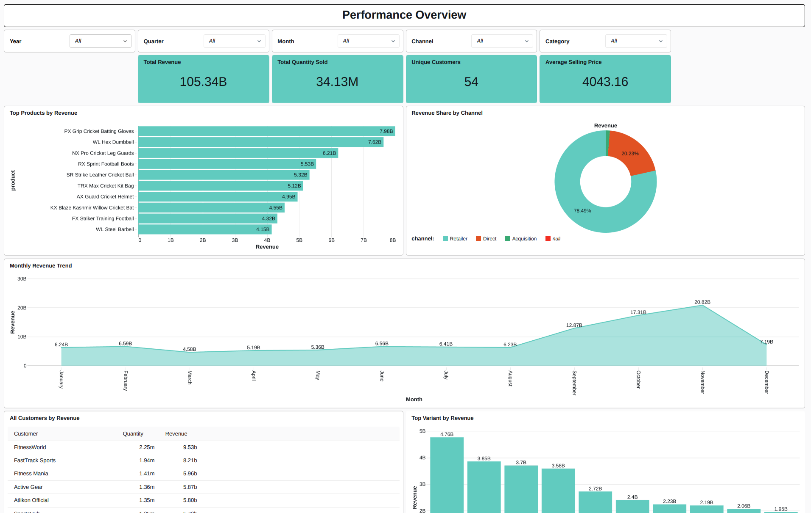

# FMCG Lakehouse | Enterprise Data Integration on Databricks



An end-to-end data engineering project demonstrating how to integrate an acquired company's inconsistent and unstandardized data into an established enterprise lakehouse.

Built using **Databricks, PySpark, SQL, Delta Lake and Amazon S3**, this solution implements a medallion architecture with automated data ingestion, transformation, historical backfills, incremental processing and enterprise data consolidation.

The final output is a unified Gold layer combining parent and acquired-company data, enabling consolidated business intelligence through Databricks AI/BI Dashboards and natural-language analytics using Databricks Genie.

---

## Business Scenario

A large FMCG (Fast-Moving Consumer Goods) company acquires a smaller business.

The parent company already maintains a structured lakehouse with established Bronze, Silver and Gold layers, supporting full and incremental data processing. However, the acquired company's data is inconsistent, unstandardized and requires extensive cleaning before it can be integrated.

The objective is to consolidate both companies into a unified lakehouse while maintaining the parent's existing data architecture and enabling reliable analytics across the combined business.

**Project Objectives**

- Ingest raw data from the acquired company using Amazon S3.
- Clean, validate and standardize inconsistent source records.
- Implement historical full loads and incremental data processing.
- Integrate acquired-company dimensions and facts into the parent's existing Gold tables.
- Implement Delta Lake MERGE operations for data integration.
- Build a unified analytical layer for consolidated reporting.
- Enable business stakeholders to explore data through AI/BI dashboards and natural-language queries.

---

## Solution Architecture

The project follows a medallion lakehouse architecture with an additional staging layer to support incremental data processing.


### Data Flow

```text
Amazon S3
    |
    v
+----------------------+
|       BRONZE         |
|    Raw Ingestion     |
| Full + Incremental   |
+----------------------+
    |
    v
+----------------------+
|       STAGING        |
| Incremental Landing  |
|       Zone           |
+----------------------+
    |
    v
+----------------------+
|       SILVER         |
| Data Cleaning        |
| Standardization      |
| Transformations      |
+----------------------+
    |
    v
+----------------------+
|        GOLD          |
| Dimensions + Facts   |
| Delta MERGE/UPSERT   |
+----------------------+
    |
    v
+----------------------+
| Unified Gold Layer   |
| Parent + Acquired    |
| Company Data         |
+----------------------+
    |
    v
+----------------------+
| Denormalized View    |
+----------------------+
    |
    +-------------------+
    |                   |
    v                   v
 AI/BI Dashboard    Databricks Genie
```

---

## Technology Stack

| Category | Technologies |
|---|---|
| Programming | Python, SQL |
| Distributed Processing | Apache Spark, PySpark |
| Data Platform | Databricks |
| Cloud Storage | Amazon S3 |
| Storage Format | Delta Lake |
| Architecture | Medallion Architecture |
| Data Engineering | ETL/ELT, Full Loads, Incremental Loads |
| Data Integration | Delta MERGE, UPSERT |
| Processing Logic | SQL Window Functions |
| Orchestration | Databricks Jobs |
| Business Intelligence | Databricks AI/BI Dashboards |
| Natural Language Analytics | Databricks Genie |

---

## Pipeline Implementation

### 1. Bronze Layer – Raw Data Ingestion

The Bronze layer serves as the initial landing zone for the acquired company's source data.

- Ingests raw datasets from Amazon S3.
- Supports initial full ingestion and subsequent incremental file ingestion.
- Preserves source data for downstream transformations.
- Separates newly arriving incremental data through a staging workflow.

### 2. Silver Layer – Data Cleaning and Standardization

Transforms the acquired company's inconsistent datasets into structured and standardized records.

**Processing includes:**

- Customer data cleaning and standardization.
- Product data transformation and normalization.
- Gross price data processing.
- Handling inconsistent source values and data quality issues.
- Preparing structured datasets for downstream dimension and fact processing.

### 3. Gold Layer – Dimension Processing and Integration

Processes the acquired company's dimension data and integrates it into the parent's existing Gold tables.

**Key implementations:**

- Customer, product and gross price dimension processing.
- Delta Lake MERGE operations for upserts.
- SQL window functions for pricing-related transformation logic.
- Integration with the parent's existing dimension tables.
- Consolidation of both companies into a unified analytical structure.

### 4. Fact Processing – Historical Backfill and Incremental Loads

The fact pipeline handles both historical acquisition data and ongoing transactional updates.

**Historical Backfill**

- Processes historical order data from the acquired company.
- Transforms order records into the required fact-table structure.
- Integrates historical transactions into the consolidated Gold layer.

**Incremental Processing**

- Captures newly arriving order data through the staging layer.
- Processes daily incremental files.
- Applies the required transformations and updates to Gold fact tables.
- Uses Databricks Jobs to orchestrate incremental processing notebooks in the correct execution order.

### 5. Unified Analytics Layer

The final Gold layer provides a consolidated analytical view of both companies.

A denormalized view is created on top of the integrated dimensions and fact tables to support business intelligence, reporting and natural-language analytics.

---

## Databricks Genie – Natural Language Analytics

A Databricks Genie space is configured on top of the consolidated FMCG analytical dataset.

It enables business stakeholders to explore sales performance and ask questions in natural language without manually writing SQL queries.

**Supported Analytical Areas**

- Sales volume and revenue trends.
- Product and product-variant performance.
- Customer-level revenue analysis.
- Market and geographical comparisons.
- Sales channel performance.
- Division and category analysis.
- Monthly, quarterly and yearly performance.
- Pricing trends and growth opportunities.

**Example Business Questions**

- Which products generate the highest revenue?
- How does sales performance vary across different markets?
- Which customers contribute the most revenue?
- What are the monthly and quarterly revenue trends?
- Which sales channels contribute the highest revenue?
- How does product pricing relate to sales quantity?

---

## Business Intelligence Dashboard

The project includes a **Performance Overview** dashboard built using Databricks AI/BI.

The dashboard provides a consolidated overview of FMCG sales performance across the integrated dataset.

### Key Performance Indicators

| Metric | Value |
|---|---:|
| Total Revenue | 105.34B |
| Total Quantity Sold | 34.13M |
| Unique Customers | 54 |
| Average Selling Price | 4,043.16 |

### Dashboard Features

- Overall revenue and sales quantity performance.
- Top-performing products ranked by revenue.
- Revenue contribution by sales channel.
- Monthly revenue trend analysis.
- Customer ranking by revenue.
- Top product variants.
- Price versus quantity analysis.
- Interactive filters for year, quarter, month, channel and category.

### View Dashboard

**[Open Performance Overview Dashboard (PDF)](2_dashboarding/fmcg_dashboard.pdf)**

---

## Repository Structure

```text
FMCG-Lakehouse/
│
├── 0_data/
│   └── Source datasets
│
├── 1_codes/
│   └── Data engineering notebooks and SQL scripts
│
├── 2_dashboarding/
│   └── fmcg_dashboard.pdf
│
├── resources/
│   └── project_architecture.png
│
└── README.md
```

---

## Getting Started

### Prerequisites

- AWS account with an Amazon S3 bucket.
- Databricks workspace.
- Unity Catalog access and required storage permissions.
- Python and PySpark environment.
- Source datasets for both companies.

### Setup and Execution

**Step 1 – Prepare Amazon S3**

Create an S3 bucket and upload the raw datasets for both the parent and acquired companies.

**Step 2 – Configure Databricks Storage Access**

Connect Databricks to Amazon S3 through Unity Catalog external locations and configure the necessary access permissions.

**Step 3 – Execute Dimension Processing**

Run the dimension notebooks in the required order to ingest, clean, standardize and merge the acquired company's dimension data into the parent's Gold tables.

**Step 4 – Execute Fact Processing**

Run the historical fact-table backfill before initiating incremental processing.

**Step 5 – Configure Incremental Processing**

Create a Databricks Job to orchestrate the incremental processing notebooks in the correct execution order.

**Step 6 – Build the Analytics Layer**

Create the unified denormalized analytical view using the consolidated Gold tables.

**Step 7 – Configure Business Intelligence**

Build the AI/BI dashboard and configure the Databricks Genie space using the unified analytical dataset.

---

## Security and Configuration

- No AWS credentials, access keys, tokens or Databricks secrets are stored in the repository.
- Configure cloud credentials using Databricks secrets or environment variables.
- Use Unity Catalog and appropriate storage permissions to manage data access.
- Source datasets and cloud configurations must be provided separately.

---

## Key Engineering Concepts Demonstrated

- Enterprise Lakehouse Architecture
- Medallion Architecture (Bronze, Silver and Gold)
- Full and Incremental ETL/ELT Pipelines
- Historical Data Backfilling
- Distributed Data Processing with PySpark
- Delta Lake MERGE and UPSERT Operations
- Dimensional Data Integration
- SQL Window Functions
- Data Cleaning and Standardization
- Databricks Job Orchestration
- Unified Analytical Data Models
- AI-Powered Business Intelligence
- Natural Language Data Exploration

---

**Project Focus:** Enterprise Data Engineering | FMCG Analytics | Lakehouse Integration | Databricks | PySpark | Delta Lake
