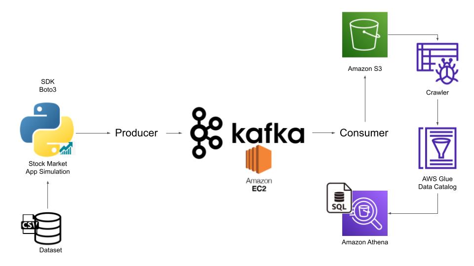
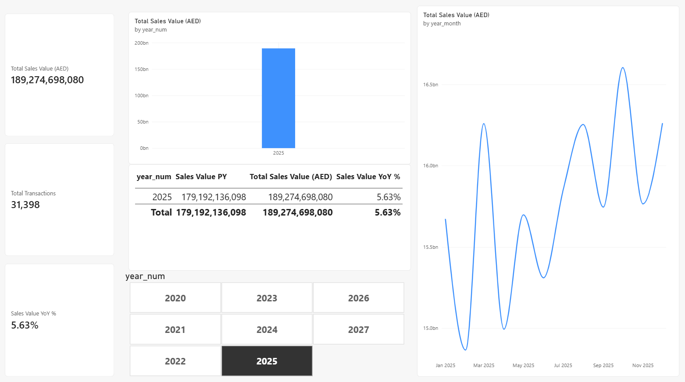
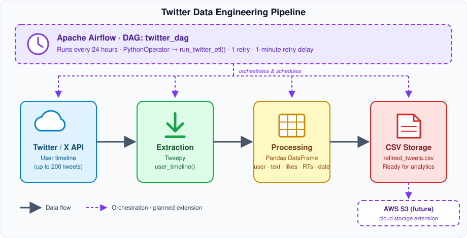

# Data Engineering Projects

### End-to-End Data Platforms | Big Data | Real-Time Streaming | Cloud Data Engineering | Lakehouse Architecture

A collection of 8 end-to-end data engineering projects demonstrating the design and implementation of scalable data platforms, distributed processing systems, real-time streaming pipelines, cloud data warehouses, and modern lakehouse architectures.

The projects cover the complete data engineering lifecycle, from data ingestion and transformation to orchestration, data quality, dimensional modelling, analytics, and AI-powered applications.

---

## Projects at a Glance

| # | Project | Focus | Core Technologies |
|---|---|---|---|
| 01 | [NYC Taxi Lakehouse](./01-nyc-taxi-lakehouse) | Distributed batch and streaming lakehouse | Hadoop, Spark, Hive, Kafka, Airflow, HBase |
| 02 | [Lambda Architecture Platform](./02-lambda-architecture) | Real-time ML inference and batch processing | Kafka, HDFS, HBase, Spark, XGBoost, PostgreSQL |
| 03 | [Zomato Data & AI Platform](./03-zomato-data-ai-platform) | Cloud ELT, medallion architecture and AI analytics | AWS S3, Snowflake, dbt, Airflow, OpenAI |
| 04 | [FMCG Lakehouse on Databricks](./04-fmcg-lakehouse-databricks) | Incremental ETL and medallion architecture | Databricks, PySpark, SQL, Delta Lake |
| 05 | [Kafka + AWS Stock Streaming](./05-kafka-aws-stock-streaming) | Real-time ingestion and cloud data lake | Kafka, Python, AWS S3, Glue, Athena |
| 06 | [Telecom Hadoop Platform](./06-telecom-hadoop-platform) | Distributed processing and data quality | Hadoop, HDFS, YARN, Spark, Hive, Docker |
| 07 | [Dubai Real Estate Data Warehouse](./07-dubai-real-estate-dw) | Data warehousing, dimensional modelling and BI | Python, SQL, Star Schema, Power BI |
| 08 | [Twitter/X Airflow Pipeline](./08-twitter-airflow-pipeline) | Automated and orchestrated ETL | Python, Airflow, Tweepy, Pandas |

---

# Project Showcase

## 01. NYC Taxi – Distributed Big Data Lakehouse

<sub>BIG DATA ENGINEERING · DISTRIBUTED COMPUTING · BATCH & STREAMING</sub>

An end-to-end big data lakehouse built using the NYC Taxi dataset, demonstrating distributed data storage, large-scale processing, batch and streaming pipelines, and analytical data modelling.

**Architecture & Technologies**

- Distributed storage using Hadoop HDFS.
- Resource management with YARN.
- Distributed processing using MapReduce and Apache Spark.
- SQL-based analytics using Apache Hive.
- Real-time event ingestion using Apache Kafka.
- Workflow orchestration using Apache Airflow.
- NoSQL storage using Apache HBase.
- Data quality validation and dimensional modelling.

**Core Stack:** Hadoop · HDFS · YARN · MapReduce · Spark · PySpark · Hive · Kafka · Airflow · HBase

[Explore Project →](./01-nyc-taxi-lakehouse)

---

## 02. Real-Time Big Data Platform – Lambda Architecture

<sub>REAL-TIME STREAMING · MACHINE LEARNING · DISTRIBUTED SYSTEMS</sub>

An end-to-end distributed data platform implementing Lambda Architecture, combining batch processing and real-time stream processing with machine learning inference.

**Architecture & Technologies**

- Apache Kafka for real-time event ingestion.
- Hadoop HDFS for distributed batch data storage.
- Apache Spark for distributed data processing.
- Apache HBase for low-latency data access.
- XGBoost for machine learning inference.
- PostgreSQL for structured data persistence.
- Spring Boot for application and serving-layer integration.

**Core Stack:** Apache Kafka · Hadoop · HDFS · HBase · Spark · XGBoost · PostgreSQL · Spring Boot

[Explore Project →](./02-lambda-architecture)

---

## 03. Zomato – Cloud Data & AI Engineering Platform

<sub>CLOUD DATA ENGINEERING · MODERN ELT · AI-POWERED ANALYTICS</sub>

A cloud-based data engineering platform implementing scalable ELT pipelines, medallion architecture, incremental transformations, and AI-powered analytical capabilities.

**Architecture & Technologies**

- Amazon S3 for cloud-based data storage.
- Snowflake as the cloud data warehouse.
- dbt for modular SQL transformations and data modelling.
- Apache Airflow for workflow orchestration.
- Medallion architecture for Bronze, Silver, and Gold data layers.
- OpenAI-powered review enrichment and intelligent analytics.
- Retrieval-Augmented Generation (RAG) for conversational data exploration.
- Text-to-SQL for natural-language querying of warehouse data.

**Core Stack:** AWS S3 · Snowflake · dbt · Apache Airflow · OpenAI · SQL · Python

[Explore Project →](./03-zomato-data-ai-platform)

---

## 04. FMCG – Databricks Lakehouse Platform

<sub>DATABRICKS · DELTA LAKE · INCREMENTAL DATA PROCESSING</sub>

A modern lakehouse platform integrating data from a parent company and an acquired subsidiary, implementing incremental processing, historical backfills, and medallion architecture.

**Architecture & Technologies**

- Data integration across multiple business entities.
- Bronze, Silver, and Gold medallion layers.
- Full and incremental data loading.
- Historical backfills and data reconciliation.
- Delta Lake for reliable lakehouse storage.
- PySpark and SQL transformations.
- Generated date dimension for analytical reporting.
- Final analytical dashboard.

**Core Stack:** Databricks · PySpark · SQL · Delta Lake

**Architecture Diagram**


[Explore Project →](./04-fmcg-lakehouse-databricks)

---

## 05. Real-Time Stock Market Streaming – Kafka & AWS

<sub>EVENT-DRIVEN ARCHITECTURE · CLOUD DATA LAKE · STREAMING ETL</sub>

A real-time stock market data pipeline that generates simulated stock trade events, streams them through Apache Kafka, and delivers the data into AWS for cataloguing and analytical querying.

**Architecture & Technologies**

- Python-based stock market event generation.
- JSON event streaming through Apache Kafka.
- Amazon S3 for persistent cloud data storage.
- AWS Glue Crawler for schema discovery and cataloguing.
- AWS Glue Data Catalog for metadata management.
- Amazon Athena for SQL-based querying.

**Core Stack:** Python · Apache Kafka · Amazon S3 · AWS Glue · Amazon Athena

**Architecture Diagram**



[Explore Project →](./05-kafka-aws-stock-streaming)

---

## 06. Telecom – Distributed Hadoop & Spark Processing Platform

<sub>TELECOMMUNICATIONS DATA · DISTRIBUTED PROCESSING · DATA QUALITY</sub>

A containerized big data engineering platform designed to process telecommunications call detail records (CDRs), demonstrating distributed computation, data validation, and performance benchmarking.

**Architecture & Technologies**

- Automated CDR data generation.
- Hadoop HDFS for distributed storage.
- YARN for cluster resource management.
- MapReduce jobs for distributed processing.
- Apache Spark and PySpark for data transformations.
- Apache Hive for SQL-based analytics.
- Data quality validation and automated testing.
- Docker-based environment and reproducible execution.
- Performance benchmarking across processing engines.

**Core Stack:** Hadoop · HDFS · YARN · MapReduce · Spark · PySpark · Hive · Docker · pytest

**Performance Results:** See the [Benchmark Results](./06-telecom-hadoop-platform/results.md).

[Explore Project →](./06-telecom-hadoop-platform)

---

## 07. Dubai Real Estate – Data Warehouse & BI Analytics

<sub>DATA WAREHOUSING · DIMENSIONAL MODELLING · BUSINESS INTELLIGENCE</sub>

An end-to-end data warehouse built around Dubai real estate transaction data, implementing automated ETL, data quality validation, dimensional modelling, historical tracking, and interactive business intelligence dashboards.

**Architecture & Technologies**

- Python-based data ingestion and ETL pipeline.
- Data cleaning, validation, and duplicate handling.
- SQL-based dimensional modelling.
- Kimball-style star schema.
- Slowly Changing Dimension Type 2 (SCD Type 2).
- Data quality checks and pipeline monitoring.
- Power BI dashboards and DAX measures.
- Analytical reporting on property sales and market trends.

**Core Stack:** Python · Pandas · SQL · SQLAlchemy · Star Schema · SCD Type 2 · Power BI

**Executive Dashboard**



[Explore Project →](./07-dubai-real-estate-dw)

---

## 08. Twitter/X – Automated ETL Pipeline with Airflow

<sub>DATA INGESTION · ETL AUTOMATION · WORKFLOW ORCHESTRATION</sub>

An automated data engineering pipeline that extracts Twitter/X data, transforms raw records into structured datasets, and orchestrates execution through Apache Airflow.

**Architecture & Technologies**

- Data extraction using Tweepy.
- API-based data ingestion.
- Data transformation and cleaning using Pandas.
- Apache Airflow DAG-based orchestration.
- Scheduled and repeatable pipeline execution.
- Structured output for downstream analytics.

**Core Stack:** Python · Apache Airflow · Tweepy · Pandas

**Architecture Diagram**



[Explore Project →](./08-twitter-airflow-pipeline)

---

# Technical Skills Demonstrated

| Engineering Domain | Technologies & Concepts |
|---|---|
| **Programming & Querying** | Python, SQL, PySpark |
| **Big Data Ecosystem** | Hadoop, HDFS, YARN, MapReduce, Spark, Hive, HBase |
| **Real-Time Streaming** | Apache Kafka, event-driven architectures, Lambda Architecture |
| **Data Warehousing** | Snowflake, PostgreSQL, dimensional modelling, Star Schema |
| **Lakehouse Architecture** | Databricks, Delta Lake, Medallion Architecture |
| **ETL / ELT Engineering** | Data ingestion, transformation, incremental loading, historical backfills |
| **Workflow Orchestration** | Apache Airflow, DAGs, scheduled pipelines |
| **Cloud Engineering** | AWS S3, AWS Glue, Amazon Athena |
| **Data Modelling** | Fact and dimension tables, SCD Type 2, analytical schemas |
| **Data Quality & Reliability** | Validation, reconciliation, duplicate detection, automated testing |
| **Business Intelligence** | Power BI, DAX, Tableau |
| **AI & Data Applications** | OpenAI, RAG, LLM-powered analytics, Text-to-SQL |
| **Engineering & DevOps** | Docker, pytest, Git, Makefiles |

---

# Repository Structure

```text
data-engineering-portfolio/
│
├── 01-nyc-taxi-lakehouse/
│   └── README.md
│
├── 02-lambda-architecture/
│   └── README.md
│
├── 03-zomato-data-ai-platform/
│   └── README.md
│
├── 04-fmcg-lakehouse-databricks/
│   └── README.md
│
├── 05-kafka-aws-stock-streaming/
│   └── README.md
│
├── 06-telecom-hadoop-platform/
│   └── README.md
│
├── 07-dubai-real-estate-dw/
│   └── README.md
│
├── 08-twitter-airflow-pipeline/
│   └── README.md
│
└── README.md
```

---

# Getting Started

Each project is maintained in its own directory and includes project-specific documentation, architecture diagrams, setup instructions, and implementation details.

To explore a project:

1. Open the corresponding project directory.
2. Review its README for architecture and technical implementation.
3. Follow the documented prerequisites and installation steps.
4. Configure the required environment variables and credentials.
5. Run the pipeline using the project-specific instructions.

**Environment & Security**

- Cloud credentials are configured through environment variables.
- Sensitive configuration is excluded from version control.
- Use the provided example environment files where available.
- Individual project READMEs contain specific setup and execution requirements.

---

# About

**Thejaswini Sunil**

AI Engineer | Data Engineering | Cloud & AI Automation

Based in Dubai, UAE.


**Connect with me:**

- GitHub: [@ThejaswiniSunil](https://github.com/ThejaswiniSunil)
- LinkedIn: [Thejaswini Sunil](https://www.linkedin.com/)

---

*Building data platforms from ingestion to insight.*
